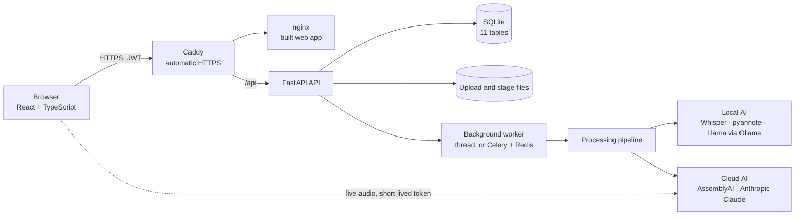
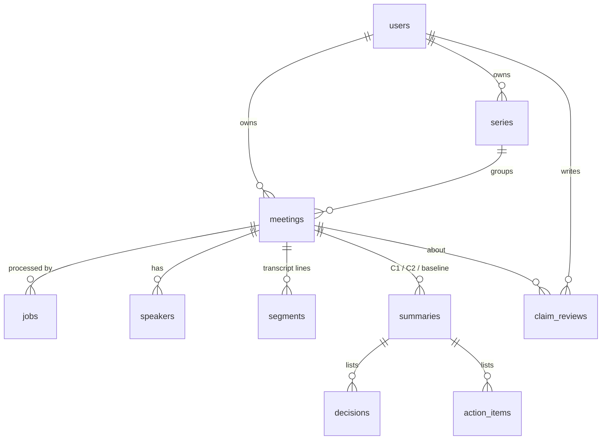
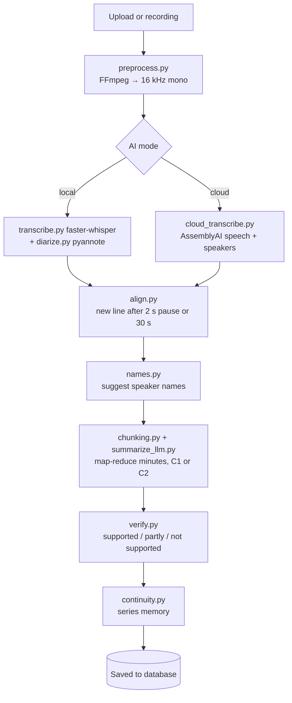
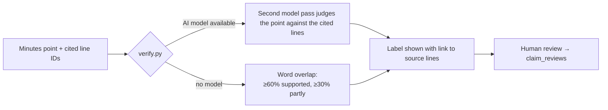
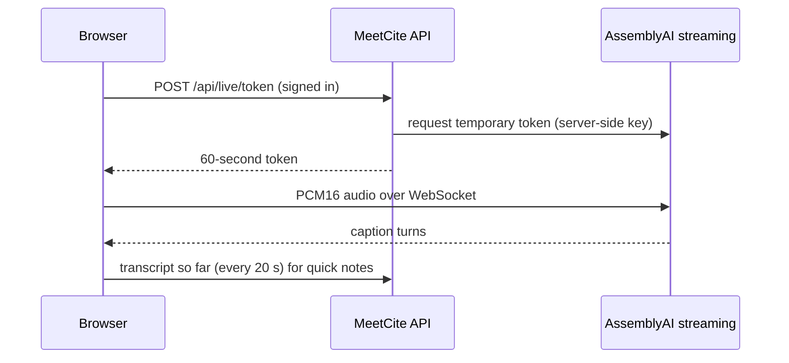
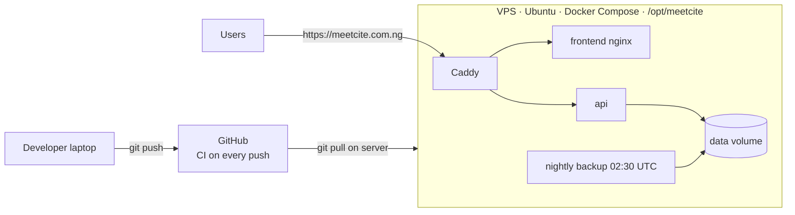

# MeetCite technical architecture

This document describes the system **as built** on `main` (November 2026). Proposed changes are kept separately, in
the last section and in [ROADMAP.md](ROADMAP.md). For how the code was written, see
[AI_USAGE_AND_DECLARATION.md](AI_USAGE_AND_DECLARATION.md).

## 1. Overall system

* **One setting picks the AI mode.** `AI_PROVIDER=local` keeps all processing on the server. `AI_PROVIDER=cloud`
  uses AssemblyAI for speech and Claude for the minutes and the AI check.
* **Background jobs.** The live server runs them in a thread (`TASK_MODE=thread`). Celery with Redis is also
  supported.

## 2. Frontend (`frontend/`)

* **Stack.** React 18, TypeScript, Vite, Tailwind CSS. TanStack Query fetches data and polls job progress.
* **Pages.** Landing, sign-in and sign-up, dashboard, upload, record, meeting, series.
* **Meeting tabs.** The meeting page has 11 tabs, including summary, actions, decisions, evidence, follow-up,
  memory, transcript and "ask" (questions answered from the transcript).
* **Key parts.**
  * `src/lib/api.ts` (API client)
  * `src/lib/useRecorder.ts` (recording and PCM audio for live captions)
  * `src/lib/useLiveCaptions.ts`
  * `src/lib/attention.ts` (ranking what needs attention)
  * `src/components/Buddy.tsx` (the mascot)
* **Tests.** Vitest unit tests in `src/test/`. Playwright browser tests in `e2e/`, including the 11-width screen
  test.

## 3. Backend (`backend/app/`)

* **Stack.** FastAPI, Pydantic v2, SQLAlchemy 2, Alembic.
* **Routers** (34 endpoints):

  | Router | Prefix | Purpose |
  |---|---|---|
  | `auth.py` | `/api/auth` | Sign-up (optional code), sign-in, current user |
  | `meetings.py` | `/api/meetings` | Upload, list, detail, status, media, exports, delete |
  | `edits.py` | `/api` | Rename speakers, edit actions and decisions |
  | `claims.py` | `/api/claims` | Human review of flagged claims |
  | `series.py` | `/api/series` | Meeting series and continuity |
  | `live.py` | `/api/live` | Live-caption token and quick notes |

* **Other modules.**
  * `security.py`: Argon2 password hashing and JWT tokens.
  * `ratelimit.py`: sign-in attempt limit.
  * `storage.py`: saving uploads.
  * `export.py`: TXT, DOCX and PDF exports.
  * `jobs.py`: starting jobs.

## 4. Database

SQLite, created by four Alembic migrations (`0001` initial, `0002` detailed minutes, `0003` configurations and
reviews, `0004` series, agenda and continuity).

`evaluation_runs` stands alone: it records research experiment runs (E1 to E5) and is not linked to other tables.
Look at `backend/app/models.py` for the exact columns; this diagram is simplified.

## 5. AI processing pipeline (`backend/app/pipeline/`)

* `runner.py` runs the stages and records progress and timings. Each stage's output is written atomically to disk,
  so a retried job **resumes from the last finished stage**.
* `llm_clients.py` talks to Ollama (local) or the Anthropic API (cloud). It caps output length and retries invalid
  JSON.
* `summary_schema.py` validates the minutes' structure.
* `summarize_bart.py` is a BART baseline for the research.
* `ask.py` answers questions about a meeting from its transcript.
* `fake.py` is a fake AI mode used by tests.

## 6. Transcription workflow

1. FFmpeg converts the file to 16 kHz mono WAV and checks the length limit (2 hours).
2. **Local:** faster-whisper (`large-v3-turbo`) transcribes; pyannote 3.1 separates speakers.
   **Cloud:** AssemblyAI does both.
3. `align.py` gives each word a speaker and groups the words into numbered transcript lines. Those line IDs are
   what citations point to.

## 7. Summarisation workflow

* Long transcripts are split into chunks. Each chunk is summarised (map), then the results are combined (reduce)
  into minutes, decisions and action items with owners and deadlines.
* **C1 (plain):** no citations.
* **C2 (evidence-grounded):** every point must list the transcript line IDs that support it.
* Both use the same model, transcript and output fields; only the citation instruction differs. This is the
  research comparison.

## 8. Evidence verification

## 9. Series memory

Meetings can belong to a series. `continuity.py` carries open action items into the next meeting, keeps a decision
history, and flags a decision that changed between meetings, showing both sources. Agenda items are marked as
covered or not.

## 10. Live captions

The API key never reaches the browser. Live captions are available only in cloud mode.

## 11. Authentication

* Passwords are hashed with **Argon2**. Sign-in returns a **JWT**, valid for 60 minutes by default.
* Media files use separate short-lived, meeting-specific tokens.
* Sign-up can require a group code (`REGISTRATION_CODE`).
* Sign-in attempts are rate-limited (10 per minute by default).

## 12. Data storage

* The database and uploads live in a data folder outside the code: `C:\MeetMindData` locally, a Docker volume on
  the server.
* Each pipeline stage writes intermediate files next to the upload.
* Deleting a meeting removes its database rows and files.

## 13. Privacy and security

* Each user sees only their own meetings.
* Secrets are kept in `.env` files, never in Git.
* The server package excludes documents, recordings and databases.
* Server:
  * HTTPS only;
  * firewall allows ports 22, 80 and 443 only;
  * SSH by key only;
  * nightly backups, with a tested restore.
* Cloud mode sends audio and text to AssemblyAI and Anthropic under their API terms. Local mode sends nothing out.
* The planned user study sends only public AMI corpus audio to the cloud.

## 14. External services

| Service | Used for | Mode |
|---|---|---|
| AssemblyAI | Transcription, speakers, live captions | Cloud |
| Anthropic Claude API | Minutes, AI check, quick notes | Cloud |
| Hugging Face | Download of pyannote and BART models | Local |
| Ollama | Runs Llama 3.1 locally | Local |
| GitHub Actions | CI | — |

## 15. Deployment

* Defined in `docker-compose.cloud.yml` (services: `api`, `frontend`, `caddy`).
* Server setup and the update command are in [DEPLOYMENT.md](DEPLOYMENT.md). The backup script is
  `deploy/cloud/meetcite-backup.sh`.
* The server is a single VPS with 1 CPU and 2 GB of memory (plus 2 GB of swap).

## 16. Proposed improvements [Planned]

These are **not built**:
* Off-server backup copies.
* Uptime and error monitoring.
* A load test.
* PostgreSQL if usage grows beyond one server.
* Account deletion in the app.
* MOV and MKV uploads.
* A WCAG 2.2 AA accessibility audit.
* Team workspaces.

Details are in [ROADMAP.md](ROADMAP.md).
