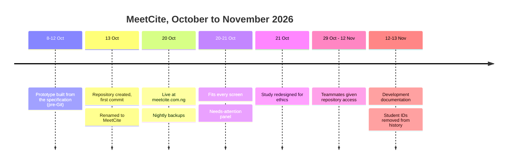

# MeetCite development timeline

A dated overview. The full detail and evidence for each stage are in [DEVELOPMENT_LOG.md](DEVELOPMENT_LOG.md).

The labels mean the same as there:
* **[Git]**: verifiable in the repository.
* **[Session log]**: from the private, timestamped Claude Code record.
* **[Retrospective]**: explained afterwards.
* **[Planned]**: not done yet.

"Responsible" names the person who directed or owns the work. Code was generated by Claude Code throughout; see
[AI_USAGE_AND_DECLARATION.md](AI_USAGE_AND_DECLARATION.md).

## At a glance

## 1. Project initiation (before 8 Oct 2026)

* **What happened.** Group 8 formed and wrote the project specification.
* **Responsible.** Group 8.
* **Evidence gap.** Nothing in the repository or the session record shows who wrote the specification or when
  the group formed.

## 2. Requirements and planning (8 to 12 Oct)

* **Developed.** Features taken from the specification and checked against it, the group draft and the university
  guidelines **[Session log]**.
* **Delivered.** `docs/AUDIT.md` and the task allocation, which gave each member one technical area, with Kenneth
  as Group Lead and Olayinka as Project Design Lead (11 Oct) **[Session log]**.
* **Responsible.** Olayinka.

## 3. Initial prototype (8 to 13 Oct)

* **Why.** A working system was needed before evaluation could start.
* **Delivered.** A full-stack app with a processing pipeline, C1/C2 minutes and the AI check. It arrived in one
  commit on 13 Oct (`cc4aaca`, tag `v0.1-prototype`) **[Git]**.
* **Responsible.** Olayinka (direction) and Claude Code (code).
* **Evidence gap.** The day-to-day steps are not in Git; they are only in the session record.

## 4. Core functionality (8 to 11 Oct)

* **Delivered.** Accounts, uploads, recording, transcript, minutes, decisions, actions, exports and the dashboard
  **[Git]**.
* **Challenges.** A sign-in failure (8 Oct) and the record button's contrast (11 Oct) **[Session log]**.

## 5. AI integration (8 to 9 Oct)

* **Decision.** Local AI was too slow on a laptop (reported 8 and 9 Oct), so a cloud mode was added and both modes
  were kept **[Session log]**.
* **Delivered.** Local mode (Whisper, pyannote, Llama) and cloud mode (AssemblyAI, Claude) **[Git]**.

## 6. Feature expansion (9 to 13 Oct)

* **Delivered.**
  * Mindy, the mascot (11 Oct).
  * Notification chime and sign-up code (9 Oct).
  * Series memory, after the owner proposed following meetings "from start to finish" (11 Oct).
  * Live captions, tested by the owner on 11 Oct.
  * Name changed to MeetCite (13 Oct, `38b95de`) **[Git]**.

## 7. Testing and quality assurance (throughout)

* **Delivered.** 85 backend, 34 unit and 6 browser tests, plus CI on every push. All CI runs on `main` have passed
  **[Git]**.
* **Gap.** No line-by-line human code review yet **[Planned]**.

## 8. Production deployment (15 to 20 Oct)

* **What happened.**
  * The owner asked to go live on 15 Oct.
  * Two shared-hosting plans turned out to be unsuitable, so a VPS was used.
  * The site went live with HTTPS and nightly backups on 20 Oct (`bed2b35`, tag `v1.0-live`) **[Git]** **[Session log]**.
* **Responsible.** Olayinka (hosting, keys, approval). Emmanuel is the deployment owner from now on.

## 9. Continuous improvement (20 Oct onwards)

* **Delivered.**
  * Mobile layout (`c76c80e`, `ec742a1`).
  * The "needs attention" panel (`9bc1d36`).
  * The study redesigned so nobody is recorded (`7ba24b3`).
  * Pascal and Chinonye given repository access on 29 Oct; Kenneth invited on 12 Nov.
  * Documentation (12 to 13 Nov) **[Git]** **[Session log]**.
* **Next.** Ethics approval, the user study, the evaluation, and team pull requests [ROADMAP.md](ROADMAP.md) **[Planned]**.

## Lessons learned

* Building before the repository existed left a gap in the history; working in the repository from day one would
  have avoided it.
* Speed mattered more to users than running everything locally, so both modes were kept.
* Automated browser tests found layout bugs that people missed.
