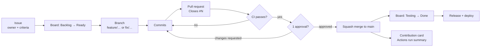

# Development workflow

How a piece of work travels from an idea to the live site. The short rules are in
[CONTRIBUTING.md](../CONTRIBUTING.md).



## Branches

* **`main`** is the stable, deployable branch. It is protected:
  * changes arrive only through pull requests;
  * one approval and passing CI are required;
  * nobody can force-push to it or delete it.
* **Short-lived branches**, one per issue, deleted automatically after merge:

| Prefix | For | Example |
|---|---|---|
| `feature/` | New behaviour | `feature/user-authentication`, `feature/export-system` |
| `fix/` | Bugs | `fix/mobile-layout` |
| `docs/` | Documentation | `docs/team-workflow` |
| `test/` | Tests and CI | `test/e2e-in-ci` |
| `research/` | Evaluation scripts and results | `research/ami-wer` |

There is **no `develop` branch**. With five people and one live server, a second long-lived branch would add merge
work without adding safety. Protected `main` with small pull requests (the "GitHub flow" model) is enough. This
can be revisited if the team or release cadence grows.

## The project board

The board is called "MeetCite development" (under the repository's **Projects** tab).

| Column | Meaning | Who moves it |
|---|---|---|
| Backlog | Agreed idea, not yet ready | Anyone |
| Ready | Has an owner, description and completion criteria | Owner or Group Lead |
| In Progress | Branch exists, work started | Owner |
| In Review | Pull request open | Owner |
| Testing | Merged; being checked on local or live | Owner |
| Done | Completion criteria met and checked | Owner |

## Step by step

1. **Pick an issue** assigned to you in Ready and move it to In Progress.
2. **Branch** from up-to-date `main`:
   ```bash
   git switch main
   ```
   ```bash
   git pull
   ```
   ```bash
   git switch -c feature/mov-mkv-uploads
   ```
3. **Commit** small, meaningful steps:
   ```bash
   git commit -m "Accept .mov and .mkv in upload validation"
   ```
4. **Push and open a pull request:**
   ```bash
   git push -u origin feature/mov-mkv-uploads
   ```
   ```bash
   gh pr create --fill
   ```
   You can also open the pull request on GitHub instead of running `gh pr create`. Write "Closes #5" in the
   description and fill in the template, including the AI assistance section. Move the card to In Review.
5. **Review.** The code owner is requested automatically. Address comments with new commits on the same branch.
6. **Merge** with "Squash and merge" once CI passes and the pull request is approved. The issue closes
   automatically.
7. **Test** the result on `main` (and on the live site after the next deployment), then move the card to Done. The merged PR triggers **Show merged contribution**, which displays an attributed contribution card in the Actions run summary. Add the PR link to [Team contributions](TEAM_CONTRIBUTIONS.md) in the same change when recording the work.

## Commit message convention

* Imperative mood, describes the effect, about 72 characters at most: `Fix overdue actions missing from dashboard`.
* Add a body after a blank line when the *why* is not obvious.
* Do not commit for anyone else, and do not change author names or dates.
* **AI attribution.** Commits are authored by the person who makes them. If you used an AI tool, say so in the
  pull request's AI assistance section, which is where the project records AI use. See
  [AI_USAGE_AND_DECLARATION.md](AI_USAGE_AND_DECLARATION.md).

## Automated checks on every pull request

| Check | What it does | Blocks merging? |
|---|---|---|
| CI › backend | ruff lint and format, mypy, pytest | **Yes** |
| CI › frontend | ESLint, TypeScript, Vitest, production build | **Yes** |
| CodeQL | Security analysis of Python and TypeScript | Reports only |
| Dependabot | Weekly dependency update PRs; security alerts | They are normal PRs, reviewed like any other |
| Secret scanning and push protection | Blocks pushes containing known secret formats | Yes (on push) |

## Where contributions become visible

| Activity | Where it shows |
|---|---|
| Commits | Insights → Contributors; your GitHub profile |
| Pull requests | Pull requests tab; release notes |
| Reviews | Each PR's conversation; your profile activity |
| Issues and assignments | Issues tab; the board |
| Releases | Releases page; [CHANGELOG.md](../CHANGELOG.md) |
| Merged contribution card | Actions → **Show merged contribution** → run summary |

Record merged work in [CONTRIBUTORS.md](../CONTRIBUTORS.md) and [TEAM_CONTRIBUTIONS.md](TEAM_CONTRIBUTIONS.md). The card names the GitHub pull request author, while the linked pull request and review record provide evidence. It is not a score of effort, and project work outside Git still needs a suitable project record.
